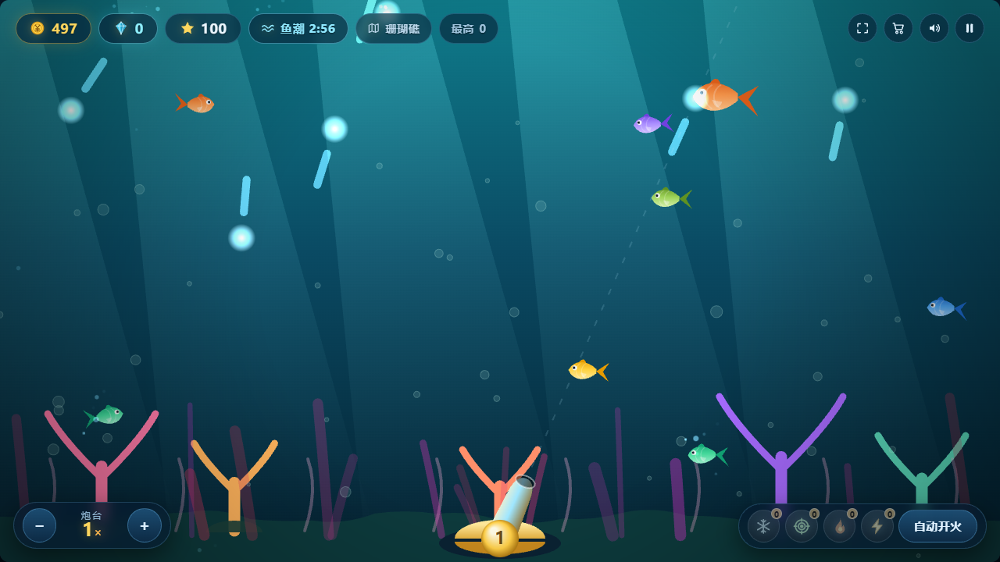
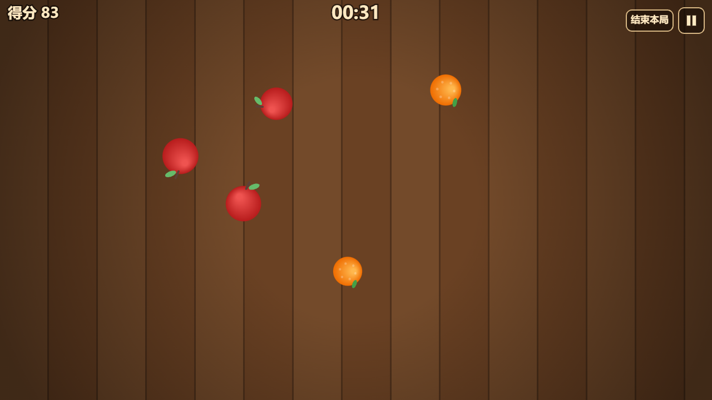
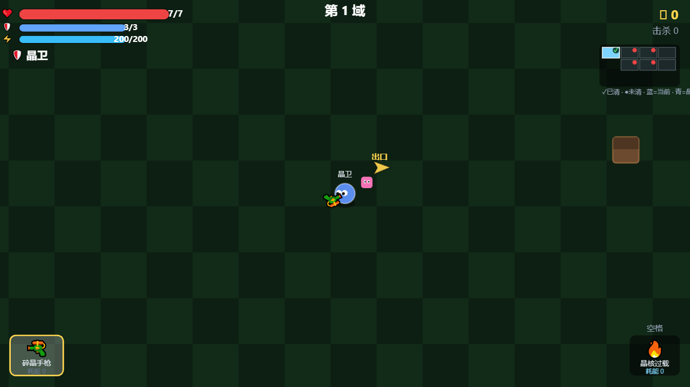
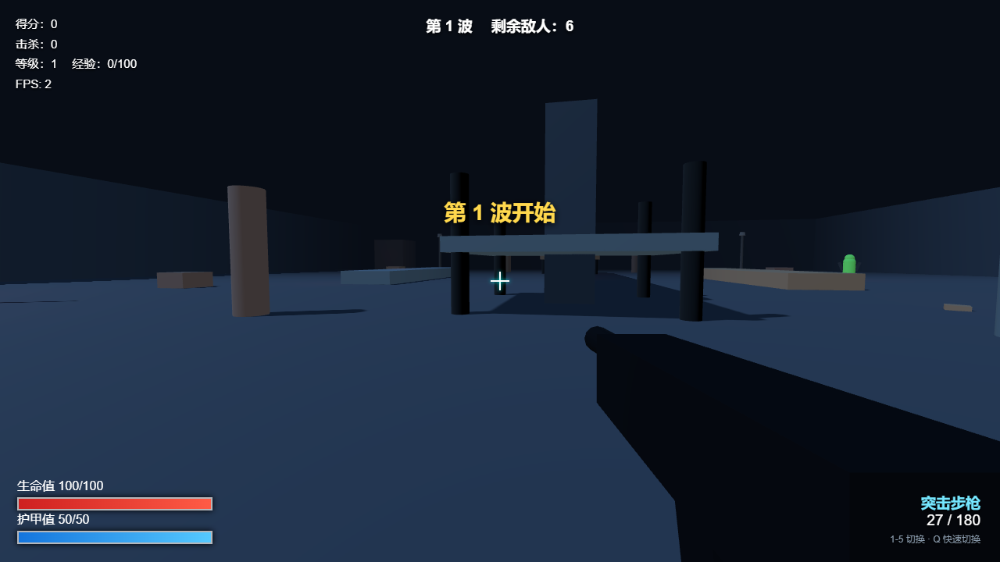

<h1 align="center">你好，我是 xiaozhe234 👋</h1>

  用原生 <b>JavaScript</b> / <b>HTML5 Canvas</b> / <b>Three.js</b> 从零写网页游戏 —— 不用游戏引擎，打开浏览器就能玩。

  
  
  

---

## 🎮 游戏作品

### 🎣 深海捕鱼

Canvas 捕鱼街机，带 **服务端权威** 的 4 人联机：炮弹本地预测、只修真实漂移的软校正、锁定道具、鱼潮调度，连队友炮台的转向都用角速度补齐，不跳帧。单机与联机**共用同一份存档**。

`HTML5 Canvas` · `Node 零依赖` · `WebSocket` · `4 人联机`

**▶ [在线试玩](https://xiaozhe234.github.io/deep-sea-fishing/)** &nbsp;·&nbsp; **[源码](https://github.com/xiaozhe234/deep-sea-fishing)**

---

### 🍉 水果忍者

原生 JS + Canvas 实现的水果忍者，**不使用任何前端框架**。经典 / 街机 / 禅模式、双人分屏对战、局域网联机；无图片无音频素材也能完整运行（自动降级为 Canvas 绘制 + 静音）。

`HTML5 Canvas` · `原生 JavaScript` · `Socket.IO` · `双人分屏`

**▶ [在线试玩](https://xiaozhe234.github.io/fruit-ninja-1/)** &nbsp;·&nbsp; **[源码](https://github.com/xiaozhe234/fruit-ninja-1)**

---

### 💎 晶域守卫者

HTML5 Canvas Roguelike：4×3 网格随机连通房间、6 名角色、25 把武器、3 个多阶段 BOSS、9 种晶悟三选一。联机部分**手写了 RFC 6455 WebSocket 帧协议**，服务器权威模拟 + 30Hz 快照同步 + 本地预测。

`HTML5 Canvas` · `Roguelike` · `自研 WebSocket 帧` · `2~4 人合作`

**▶ [在线试玩](https://xiaozhe234.github.io/crystal-guardians/)** &nbsp;·&nbsp; **[源码](https://github.com/xiaozhe234/crystal-guardians)**

---

### 🎯 枪战 PVP

Three.js 打造的网页 3D 第一人称射击：生化模式波次生存（每 5 波出 BOSS）、1v1 联机单挑，外加一个**可视化 3D 地图编辑器**。6 把武器各带独立的散布、后坐力与距离衰减，`Raycaster` 做爆头/躯干命中判定。

`Three.js` · `3D FPS` · `WebSocket 30Hz` · `地图编辑器`

**▶ [在线试玩](https://xiaozhe234.github.io/qiangzhan-pvp/)** &nbsp;·&nbsp; **[源码](https://github.com/xiaozhe234/qiangzhan-pvp)**

---

## 🛠 我常用的东西

---

<i>Hi, I'm xiaozhe234 — I build browser games from scratch with vanilla JavaScript, Canvas and Three.js.</i>

